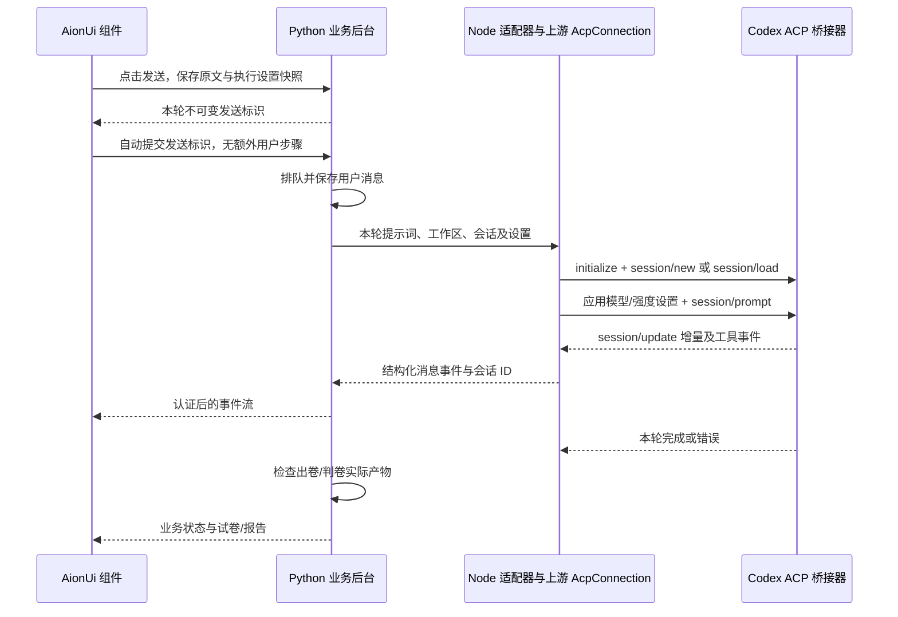

# AionUi 对话界面与 Codex 收发流程复用设计

## 已确认的目标

把当前 JLPT 网页的「输入提示词 → Codex 执行 → 查看答案」改为 AionUi 的对话体验，同时复用其 Codex 收发实现。用户明确要求绝对优先复用仓库代码，并已确认界面和底层流程均在范围内，同意采用 v1.9.25 源码复用方案。

成功标准是实际运行上游组件与连接代码，而不只是做外观相似的页面。模型和推理强度选择、出卷、作答、交卷、判卷及本地历史提交需要继续工作。根据用户 2026-10-10 的后续修订，取消提示词预览步骤，模型和强度放入聊天框，输入原文直接发送。

## 上游版本与复用边界

- 仓库：<https://github.com/iOfficeAI/AionUi>
- 固定版本：`v1.9.25`
- 固定提交：`bbada2a9268060d2b41ddf1d885a9b27ecd2103d`
- 许可证：Apache-2.0；保留版权头、许可证和上游存在的 NOTICE。
- 当前最新版的智能体后台依赖独立 `aioncore`；本次选择保留 TypeScript Codex 接入源码的版本，不引入最新版后台二进制架构。

引入源码时先尝试原文件直接使用。其次通过应用侧适配器满足其接口；只有当前网页与上游平台接口确实不兼容时才修改引入文件。每项修改注明原因，不把自行重写的模块标为直接复用。

### 直接使用的上游代码

前端以同一固定版本的以下代码为入口，按依赖闭包引入所需文件：

- `src/renderer/components/chat/sendbox`：输入框、发送和停止交互及样式。
- `src/renderer/components/agent/AcpConfigSelector.tsx`：输入框内模型和强度下拉菜单，使用原组件 local mode。
- `src/renderer/pages/conversation/Messages/MessageList.tsx`：消息列表、滚动与消息分派。
- `src/renderer/pages/conversation/Messages/components/MessageText.tsx` 及其 Markdown 渲染依赖。
- ACP 工具调用、思考和权限消息的展示组件，以及必要的消息类型、合并与展示工具。

后端连接以以下文件为入口：

- `src/process/agent/acp/AcpConnection.ts`：JSON-RPC 请求、通知、会话创建和恢复、提示词发送及取消。
- `src/process/agent/acp/acpConnectors.ts` 中的 `connectCodex` 及其必需辅助代码。
- `src/process/agent/acp/utils.ts` 和所需 ACP 类型。

不移植 Electron 主程序、完整 AionUi 首页、团队协作、定时任务和文件上传系统。当前聊天中没有后端支持的能力不显示对应操作入口。组件依赖的运行环境由明确的适配器提供，不用静默成功的空实现冒充功能。

上游源码放在 `vendor/aionui/`，记录文件原路径、提交、校验值和本地修改。应用适配器放在独立目录，便于后续比较与更新。

## 页面与交互

聊天区域改为会话列表、消息历史和底部输入框。桌面端会话列表位于侧栏；手机端通过按钮展开，消息与输入框保持可用，无横向溢出。现有试卷列表、作答和报告区域继续接在页面内。

执行器、出卷/判卷操作、模型和推理强度位于聊天输入框底部。用户输入后直接发送，不再预览；实际提示词等于用户输入原文，不附加 skill 指令，不裁剪空格、换行或截获斜杠文本。引用消息先插入可编辑输入框。发送时锁定本轮原文与设置，发送期间的新输入和新设置保留为下一轮草稿。

发送成功后在消息历史中显示用户原文，助手答案以 Markdown 展示。运行中的文本增量并入同一消息；思考、工具调用、错误和应用检查状态分别展示。原始诊断信息放入可展开区域，便于排错。

继续对话保留执行器和会话关联。停止按钮取消当前模型生成，保留已有消息和资料，也处理尚未完成的准备或入队请求。正在执行时允许编辑下一条输入，但本次不加入自动发送队列。网络失败保留草稿；相同内容重试复用同一发送标识，避免重复入队。

交卷后在所属对话中预填可编辑判卷提示词并选中判卷操作，用户直接发送。试卷、草稿冲突处理、一次性交卷和报告访问沿用现有业务接口。

智能体切换与侧栏筛选在本次后续请求中属于推荐讨论：建议切换 CLI 后筛选其历史并进入新对话，已有会话归属不变。本轮实现保留现有全部历史，等待用户对该推荐作决定。

## Codex 接入与数据流

Python 保留登录、不可变发送快照、任务排队、资料工作区、产物检查和本地提交的责任。继续复用既有 `/api/previews` 与 `/api/tasks` 事务接口，不显示预览 UI。新增 Node 适配器实际调用上游连接代码，不在 Python 中重新编写 ACP 协议。

Node 适配器接受一轮结构化输入，并向 Python 输出可解析的事件。协议输出与诊断日志分开，避免上游日志破坏事件解析。新会话通过 `newSession` 创建，后续轮次通过 `loadSession` 恢复；会话 ID 及时持久化。连接失败、模型服务错误与非正常进程退出均终止本轮并显示原因。

模型和推理强度在预览中不可变保存。适配器通过 ACP 提供的模型/配置选项应用设置：支持独立强度选项时使用对应选项；上游使用组合模型 ID 时按其公开选项映射。没有可用映射的显式选择需要报错，不能丢弃参数后执行，也不能未经提示换模型。

保留当前工作区权限范围和服务器登录配置，不因迁移自动放宽文件访问或改写用户全局 Codex 配置。上游连接器的平台服务、环境获取与日志接口按当前服务器提供。Codex ACP 包及构建依赖固定版本并纳入安装流程。

取消优先调用上游 `cancelPrompt`；超时或连接异常时执行上游进程清理，防止遗留模型进程。服务重启时保持现有任务中断恢复规则；用户重新发送后恢复已保存会话。

Qoder 和 Antigravity 继续使用各自既有调用路径，统一转换为聊天消息事件。页面切换执行器不能混用已有会话。

## 消息存储与实时传输

为聊天记录增加结构化事件数据：消息 ID、任务 ID、轮次、角色、类别、增量内容及工具状态。用户消息与任务入队在同一事务内持久化；重复发送同一预览不会重复追加消息。

优先保留当前 SQLite 存储，做向后兼容迁移。旧数据库启动后可继续读取任务、事件、试卷和草稿；既有日志事件按其类别转换为可读历史，不捏造缺失的用户消息。

网页通过带现有会话 Cookie 的事件流接收更新，按事件 ID 断线续读。切换对话关闭旧订阅；只把事件投递到所属对话。历史加载和实时事件按 ID 去重，恢复连接后不重复消息、不漏增量。

服务端继续验证登录和同源请求。流结束、登录失效、任务失败和网络断开需要恢复正确的输入/运行状态，不能让页面永久停在「正在回复」。

旧 `codex exec` 任务的历史和资料保留。尝试恢复旧会话时使用明确的会话来源标记；若 ACP 不兼容该会话，显示恢复失败并让用户新建对话，不悄悄丢弃上下文。迁移不承诺未验证的跨协议会话兼容性。

## 文件职责

| 位置 | 职责 |
| --- | --- |
| `vendor/aionui/` | 固定版本上游源码、许可与来源清单 |
| `chat/` | React 聊天入口、上游组件上下文和业务桥接适配器 |
| `agent/` | Node Codex ACP 适配器和构建入口 |
| `server/cli.py` 及新增 ACP 运行模块 | 将 Codex 轮次交给 Node，并保留其他执行器路径 |
| `server/store.py` | 消息事务、结构化事件与旧数据库兼容 |
| `server/worker.py` | 传递模型事件、会话 ID，保留产物检查流程 |
| `server/app.py` | 历史消息和认证事件流接口 |
| `web/index.html`、`web/practice.mjs`、相关样式 | 挂载聊天，接回试卷交卷/判卷交互 |
| `scripts/build-server.mjs`、部署脚本 | 构建、打包聊天与 Node 适配器，检查依赖 |

现有工作区中未提交的改动需要保留，不能用旧提交或上游文件覆盖它们。最终只提交本次明确产生的文件和修改。

## 验收

1. 来源清单能够定位每个复用文件至固定提交；构建产物实际包含并调用上游组件和 `AcpConnection`。
2. 使用可控 ACP 测试进程验证初始化、新会话、恢复、多次文本增量、工具更新、明确模型/强度选择、取消、超时、连接错误及异常退出。
3. 存储测试覆盖已有数据库迁移、用户消息幂等入队、多轮历史、增量去重和中断后会话关联。
4. HTTP 测试覆盖未登录访问、事件游标续读、预览设置不可替换、任务状态与结构化消息一致。
5. Chromium 和 WebKit 浏览器验证中文输入、预览失效、用户/助手消息、Markdown 安全展示、停止、会话切换及手机宽度。
6. 现有出卷、草稿保存/冲突、一次性交卷、判卷、报告和本地历史提交测试通过。
7. 在已有认证允许的环境中进行真实 Codex 两轮验证，确认实际答案流和恢复同一会话；如外部服务阻止验证，明确记录可复现的限制，不用模拟结果替代真实验收。

## 设计审核状态

用户已同意采用 v1.9.25 的源码复用方案，并以“执行”批准本设计的实现。

## 主题与运行验证更新（2026-10-10）

用户要求智能体下拉菜单保持深色，取消出卷／判卷选择，输入框聚焦时隐藏占位文字及内部下划线，在运行诊断提供刷新按钮。只有使用真实聊天通道成功完成验证的智能体能出现在选择列表中。

继续复用 AionUi 的 Arco 控件及既有 CLI 调用。诊断后台顺序使用临时工作目录发送随机验证文本，要求成功退出并收到对应回复；安装状态或登录命令成功不能代替实际对话。检查结果缓存至手动刷新或服务重启；刷新立即撤下旧选项，响应丢失时恢复查询。已有历史仍可查看，草稿保留。
